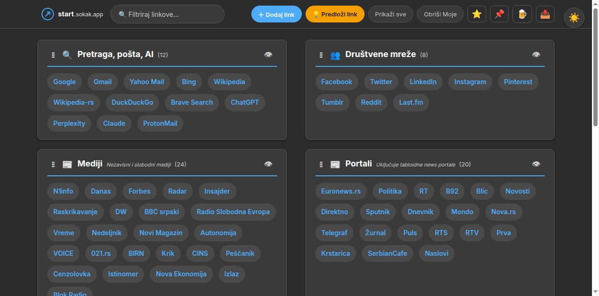
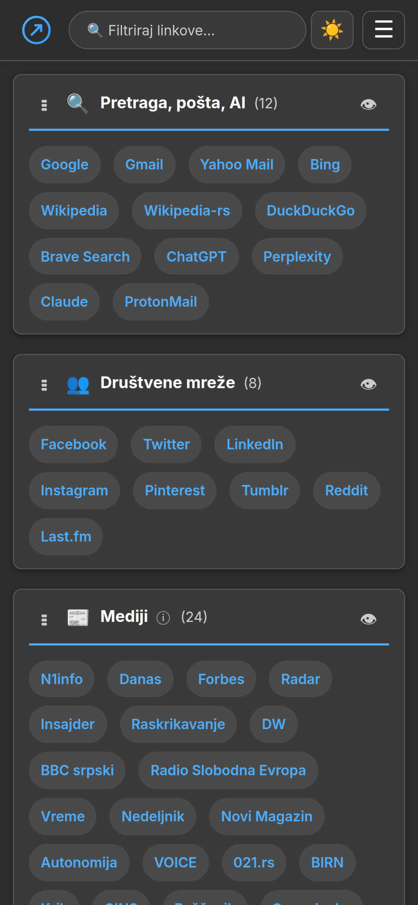

# start.sokak.app

> A personalized start page with bookmarks, search, AI tools, media,
> social networks, and utilities. One page, everything you need on
> the internet.

**Live demo:** https://start.sokak.app/

🌐 **Languages:** 👉 [🇷🇸 Srpski](README.md) · 👉 [🇬🇧 English](README.en.md)

Fast, responsive, dark/light theme, no account required, no server-side
tracking by default. All user state (favorites, custom links, sort order,
hidden categories) is stored in `localStorage` — privately, on the user's
device.

---

## ✨ Features

- **📰 100+ bookmarks** in 12+ categories (media, news portals, search,
  AI, social networks, tools, entertainment, multimedia, local services...)
- **⭐ Favorites** — drag any link into the "My Links" category. Long-press
  on mobile opens an action sheet.
- **➕ Custom links** — add your own links via the "Add link" button in
  the hamburger menu.
- **🌓 Dark / light theme** — remembers your choice automatically.
- **🔍 Live search** — filter by name or URL.
- **👁 Hide categories** — every category has a 👁 button, or use the
  ⭐/📌 buttons in the toolbar to quickly toggle "My Links" / "Custom".
- **📱 Responsive** — works on desktop, tablet, and mobile. Long-press
  support for touch devices.
- **🔀 Drag & drop** — reorder categories (desktop) or use the custom
  link form.
- **🍺 Donate** — optional PayPal button in the hamburger menu (you can
  easily replace it with your own link or remove it).
- **💡 Suggest link** — users can suggest a link. Server-side PHP sends
  an email to the administrator (see "API setup" below).
- **🔗 Share site** — Web Share API on mobile, copy-to-clipboard on desktop.
- **⚖️ Privacy-first** — NO analytics by default. No cookies. No server-side
  tracking. You can optionally add analytics (Umami, Plausible, Google
  Analytics) — see "Analytics" section.
- **♿ Accessibility** — keyboard navigation, ARIA labels, color contrast
  respects user system preferences.

---

## 📸 Screenshot

_(add a screenshot of your deployment here — see `docs/screenshots/` for examples)_




---

## 🚀 Quick start

### Option 1: Use as a static site (without the API)

1. Clone the repo:
   ```bash
   git clone https://github.com/banegrbic/start-sokak-app.git
   cd start-sokak-app
   ```

2. Open `index.html` in your browser — it works!
   ```bash
   # or with a local server:
   python3 -m http.server 8000
   # open http://localhost:8000
   ```

3. Customize:
   - Edit `<a>` tags in `index.html` to add/remove links
   - Change emoji icons and category titles
   - Adjust colors in `responsive.css` (CSS variables at the top of the file)

4. Deploy:
   - **GitHub Pages**, **Netlify**, **Cloudflare Pages**, **Vercel** — just push.
   - **cPanel / shared hosting** — see "Deployment" section below.

### Option 2: Full setup with API endpoint (for "Suggest link" button)

1. Clone as above
2. On the server, create `api/config.php` from the template:
   ```bash
   cp api/config.example.php api/config.php
   # Edit api/config.php with your email and SMTP details
   ```
3. PHP 7.4+ is required (uses `json_encode`, `filter_var`, `mail()`).

---

## 📂 Project structure

```
.
├── index.html              # Main file — all markup + inline JS
├── responsive.css          # All styles (dark/light theme, responsive)
├── api/
│   ├── suggest.php         # Server-side handler for "Suggest link"
│   └── config.example.php  # Template for config.php (NOT in git)
├── scripts/
│   ├── deploy.sh           # Generic deploy template
│   └── bump-version.sh     # Cache-busting helper
├── assets/
│   └── favicon.svg         # Favicon (SVG, transparent background)
├── favicon-{16,32,64}.png  # Favicon in various sizes
├── apple-touch-icon-...    # iOS home screen icon
├── LICENSE                 # MIT license
├── README.md               # This file (Serbian, primary)
├── README.en.md            # English translation
├── CHANGELOG.md            # Version history
└── .gitignore              # SSH secrets, config.php, backups
```

---

## ⚙️ Customization

### Adding a new category

In `index.html`, copy an existing `<section class="category">` block and
adapt it:

```html
<section class="category" id="category-my-new" data-category-name="My new">
  <header class="category-header">
    <button type="button" class="drag-handle" aria-label="Drag category">⋮⋮</button>
    <h2><span class="category-icon">🆕</span> My new <span class="count" data-count></span></h2>
    <button type="button" class="visibility-toggle" aria-label="Hide category" data-visibility-toggle>👁</button>
  </header>
  <div class="links">
    <a href="https://example.com/" draggable="true" data-href="https://example.com/" data-name="Example">Example</a>
  </div>
</section>
```

Important:
- `id="category-..."` must be unique (slug version of the name)
- `data-category-name` is used as a fallback in localStorage
- Every `<a>` MUST have `href`, `data-href`, and `data-name` (same string
  for data-name and display text)

### Adding a new link to an existing category

Find the category in `index.html` (search for `data-category-name="..."`)
and add an `<a>` inside the `<div class="links">` block:

```html
<a href="https://new-link.com/" draggable="true" data-href="https://new-link.com/" data-name="New Link">New Link</a>
```

### Changing themes

CSS variables at the top of `responsive.css` (in the `:root` block):

```css
:root {
  --primary-bg: #1a1a1a;     /* Main background */
  --secondary-bg: #2a2a2a;   /* Secondary (cards, modal) */
  --text-color: #e0e0e0;     /* Main text */
  --text-muted: #888;        /* Secondary text */
  --link-color: #4dabf7;     /* Links and accents */
  --border-color: #333;      /* Borders */
  /* ... */
}
```

For the light theme, use `@media (prefers-color-scheme: light)` or a JS
toggle (currently the user chooses manually via the theme button).

### Replacing the PayPal link

In `index.html` find `paypal.me/emocentrik` (2 places) and replace with
your own link. Or delete the 🍺 buttons entirely if you don't want a
donation option.

---

## 🔌 API setup ("Suggest link" button)

If you want the "Suggest link" button to work and send you email with
suggestions, you need to configure `api/suggest.php`.

### 1. Create `api/config.php` (NOT in git)

```bash
cp api/config.example.php api/config.php
```

Edit `api/config.php` with your values:

```php
$TO_EMAIL    = 'your-email@example.com';   // Where suggestions arrive
$FROM_EMAIL  = 'noreply@your-domain.com';  // Sender (must exist on your domain)
$FROM_NAME   = 'your-site';
$SUBJECT     = '[your-site] New link suggestion';
```

### 2. Test locally

```bash
# PHP built-in server with /api/ routing
php -S localhost:8000

# Open http://localhost:8000 — try the "Suggest link" button
```

### 3. On the server, set the executable bit

```bash
chmod 755 api/suggest.php
```

### 4. (cPanel) Make sure `mail()` works

If you're using cPanel, `mail()` usually works if you have an email
account on the domain. If it doesn't, contact hosting support or use
PHPMailer with SMTP authentication.

### Alternative backend (without PHP)

If you deploy to a static host (GitHub Pages, Netlify, Cloudflare Pages),
`api/suggest.php` won't work. Options:

1. **Disable the button** — remove the "Suggest link" HTML from the
   hamburger menu
2. **Formspree** (https://formspree.io) — replace `api/suggest.php` logic
   with a Formspree POST (see their docs)
3. **Netlify Forms** (if you use Netlify) — add `data-netlify="true"`
   attribute to the form
4. **Cloudflare Workers** — create a serverless function that sends email

---

## 📊 Analytics (optional)

The project **does NOT send any analytics data by default**. If you want
to track visits, add your tracking snippet **before `</body>`** in
`index.html`:

### Umami (recommended, privacy-friendly)

```html
<script defer src="https://cloud.umami.is/script.js" data-website-id="YOUR-WEBSITE-ID"></script>
```

### Plausible

```html
<script defer data-domain="your-domain.com" src="https://plausible.io/js/script.js"></script>
```

### Google Analytics

```html
<!-- Google tag (gtag.js) -->
<script async src="https://www.googletagmanager.com/gtag/js?id=G-XXXXXXXXXX"></script>
<script>
  window.dataLayer = window.dataLayer || [];
  function gtag(){dataLayer.push(arguments);}
  gtag('js', new Date());
  gtag('config', 'G-XXXXXXXXXX');
</script>
```

⚠️ **Warning**: Google Analytics tracks users without their consent
(in violation of GDPR in the EU). If your site is visited by EU users,
consider a cookie consent banner or use a privacy-friendly alternative
(Umami, Plausible, Fathom).

---

## 🚀 Deployment

### GitHub Pages (easiest)

1. Push to GitHub
2. Settings → Pages → Source: `master` branch, root
3. Your site is at `https://<username>.github.io/start-sokak-app/`

**Limitation**: `api/suggest.php` won't work (GitHub Pages doesn't
support PHP). See "Alternative backend" above.

### Netlify / Vercel / Cloudflare Pages

1. Push to GitHub
2. Connect the repo in Netlify/Vercel/Cloudflare dashboard
3. Build command: none (static site)
4. Publish directory: root

**Netlify specifically**: has Forms support — you can replace
`api/suggest.php` with a `data-netlify="true"` form.

### cPanel / shared hosting

`scripts/deploy.sh` is a generic template — works with any SSH-accessible
hosting.

**Setup (once):**

1. Create an SSH key for deployment:
   ```bash
   mkdir -p secrets
   ssh-keygen -t ed25519 -f secrets/deploy-key -N ""
   chmod 600 secrets/deploy-key
   ```

2. Add the public key on the server (`~/.ssh/authorized_keys`).

3. Edit `scripts/deploy.sh` — set `SSH_USER`, `SSH_HOST`,
   `REMOTE_DIR_PRIMARY`, `LIVE_URL_PRIMARY` to your values.

4. On the server, create `~/public_html/api/` and upload `config.php`.

**Each deploy:**
```bash
./scripts/deploy.sh "Description of change"
```

The script automatically:
- Bumps the cache-busting version in `index.html`
- Commits and pushes to GitHub
- SCPs files to the server
- Curls the live URL to confirm the new version

### Other static hosting (S3, Firebase, Surge.sh, etc.)

The project is 100% static (except the optional PHP). Works with anything
that serves HTML/CSS/JS files.

---

## 🤝 Contributing

Pull requests are welcome! For larger changes:

1. Open an issue first to discuss what you'd like to change
2. Fork the repo
3. Create a branch (`git checkout -b feature/new-functionality`)
4. Commit (`git commit -m 'feat: add X'`)
5. Push (`git push origin feature/new-functionality`)
6. Open a Pull Request

**Code style:**
- Vanilla JS (no TypeScript, no bundler)
- 2-space indent
- CSS classes: kebab-case (e.g. `.category-header`)
- JS functions: camelCase
- Inline JS in `<script>` tags (no external JS files)

**Before committing, test:**
- [ ] Open `index.html` in browser — no JS errors in console
- [ ] Test mobile layout (Chrome DevTools → device emulation)
- [ ] Try the "Add link", "Suggest link", theme toggle buttons
- [ ] If you changed CSS — bump `?v=` in `index.html` link
- [ ] Verify you didn't accidentally commit `api/config.php`

---

## 📜 License

This project is licensed under the **MIT License** — see the [LICENSE](LICENSE)
file for details.

In short: you can use, modify, distribute, and use commercially — just
keep the copyright notice.

---

## 🙏 Credits

- **Sortable.js** (https://github.com/SortableJS/Sortable) — drag & drop
  functionality, MIT license
- **Inter font** (https://rsms.me/inter/) — typography, SIL OFL license
- **CC BY-SA 4.0** — link content (categories, descriptions) is licensed
  under CC BY-SA 4.0 (visible in the site footer)

All links to external sites belong to their owners. This project is not
affiliated with the sites it links to.

---

## 📞 Contact

- GitHub Issues: for bugs and feature requests
- Email: see `api/config.php` (or your deployment)

---

## 🗺️ Roadmap

See [CHANGELOG.md](CHANGELOG.md) for version history.
